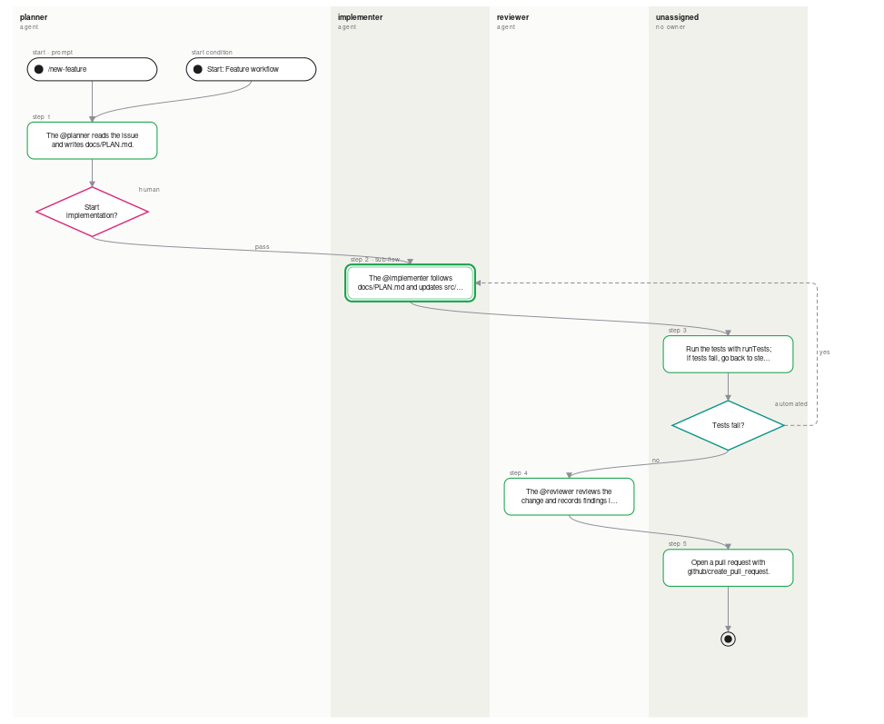

# discovery-graph

Map an **agentic harness** (`copilot-instructions.md`, agents, prompts, skills, MCP servers and tools, hooks) into a **state machine of the agent workflow**, read top to bottom:

```
● start condition   "When an issue is labelled agent" / "/new-feature"
▭ stage             planner  (reads the issue, writes PLAN.md)        ← one lane per agent
◇ gate              "Plan approved?"  human · criteria · evaluator     ← what must be true to move on
▭ stage             implementer  (reads PLAN.md, edits src/)
◇ gate              "Tests pass?"  automated   — fail ↺ back to implementer
▭ stage             reviewer
◉ end
```



…with the knowledge graph behind it (tools, MCP servers, artifacts, rules). View it, lint it, and let an AI agent enrich and review it, so you can reason about how the harness works and where to improve, evaluate or evolve it.

- **Lightweight.** One runtime dependency (`yaml`). Local scans need no network, no LLM calls and no API keys.
- **Hybrid.** A deterministic scan builds the skeleton. A generated brief lets _your_ AI agent (Copilot, Claude, anything else) add the meaning, and the validator keeps it honest.
- **Re-runnable.** Re-scanning replaces only what the scanner found. Anything an agent or a human added is kept.

## Quick start

```bash
# point it at the repo whose harness you want to map
npx discovery-graph /path/to/your/repo

# (with no path it scans the current folder — run it from inside that repo)

# or point it at a repo URL (shallow clone into a temporary directory, deleted afterwards)
npx discovery-graph https://github.com/owner/repo
```

This writes `.discovery-graph/` containing:

| file              | what it is                                                                                                                                                                    |
| ----------------- | ----------------------------------------------------------------------------------------------------------------------------------------------------------------------------- |
| `graph.json`      | the graph (schema: `discovery-graph/2`, see [docs/GRAPH-SPEC.md](docs/GRAPH-SPEC.md))                                                                                         |
| `index.html`      | self-contained viewer (open from disk). **State machine** view: start at the top, agent lanes, gates as diamonds, loops, sub-flows; **Knowledge graph** view: everything else |
| `statemachine.md` | the same state machine as Mermaid `stateDiagram-v2` — renders on GitHub / VS Code                                                                                             |
| `lint.md`         | harness analysis: workflows with no start condition, hand-offs with no gate criteria, gates with no fail path, dead-end stages, unused MCP servers, artifacts nobody reads …  |
| `AGENT_BRIEF.md`  | the prompt for an AI agent to enrich the graph and write `REVIEW.md`                                                                                                          |

Then tell your agent: **"Follow .discovery-graph/AGENT_BRIEF.md"**.

## Commands

```
discovery-graph [all] [path|url] [--out DIR]   scan + lint + brief + viewer (default)
discovery-graph scan  [path|url] [--out DIR]   deterministic scan → graph.json (keeps agent/human edits)
discovery-graph brief [path|url] [--out DIR]   write AGENT_BRIEF.md
discovery-graph validate [graph.json]          schema + edge-endpoint check (exit 1 on errors)
discovery-graph lint [graph.json] [--strict] [--json]   analysis (exit 1 on errors; --strict: on warnings too)
discovery-graph view [graph.json]              regenerate index.html + statemachine.md
discovery-graph schema                         print the JSON Schema
```

`lint --strict` works as a CI gate for harness changes.

## What it understands

| source                                                                                                             | becomes                                                                                                                                                                                   |
| ------------------------------------------------------------------------------------------------------------------ | ----------------------------------------------------------------------------------------------------------------------------------------------------------------------------------------- |
| `.github/copilot-instructions.md`, `*.instructions.md`, `AGENTS.md`, `CLAUDE.md`, `GEMINI.md`, Cursor rules        | `instruction` nodes; `applyTo` globs become constrained artifacts                                                                                                                         |
| `*.agent.md`, `*.chatmode.md`, `.claude/agents/*.md`                                                               | `agent` nodes; `tools` become `uses`, `handoffs` become `delegates_to`                                                                                                                    |
| `*.prompt.md`, `.claude/commands/*.md`                                                                             | `prompt` nodes; `agent:` becomes `invokes`                                                                                                                                                |
| `SKILL.md`                                                                                                         | `skill` nodes                                                                                                                                                                             |
| `.vscode/mcp.json`, `.mcp.json`, `.cursor/mcp.json`                                                                | `mcp_server` nodes; `server/tool` and `mcp__server__tool` become `provides` + `uses`                                                                                                      |
| `.claude/settings.json` hooks                                                                                      | `trigger` nodes                                                                                                                                                                           |
| "Workflow / Process / Steps" sections with numbered lists                                                          | a start `trigger` (from a "When …" sentence), `state`s, and `gate`s: "if tests fail, go back to step 2" → `Tests fail?` (yes ↺ / no ↓); "only once the plan is approved" → a `human` gate |
| Copilot `handoffs` / "hand off to X" / a step owned by a different agent                                           | a gate between the agents: `human` for handoff buttons, `implicit` when no criteria are written (a lint warning)                                                                          |
| an agent's own numbered steps                                                                                      | a sub-flow nested under the stage that agent performs                                                                                                                                     |
| "Agents / Tools / Artifacts" sections, NEVER/ALWAYS/MUST bullets, `` `paths` ``, `@agent` mentions, markdown links | inferred nodes and edges: `reads` / `writes` are chosen by the nearest verb                                                                                                               |

Folders named `fixtures`, `testdata`, `node_modules`, `dist`… are skipped. Everything the scanner derives from prose is marked `"confidence": "inferred"`, and everything carries a `source` file and line.

## Library use

```ts
import {
  scanRepo,
  lintGraph,
  validateGraph,
  renderViewer,
} from "discovery-graph";
const graph = scanRepo("/path/to/repo");
const report = lintGraph(graph);
```

## Development

```bash
npm install
npm test          # vitest: unit + CLI end-to-end + viewer (jsdom)
npm run lint       # ESLint checks source and tests
npm run build
npm run demo      # runs against test/fixtures/sample-repo → .discovery-graph-demo/
```

## License

Licensed under the Zero-Clause BSD license (0BSD). See [LICENSE](LICENSE).
